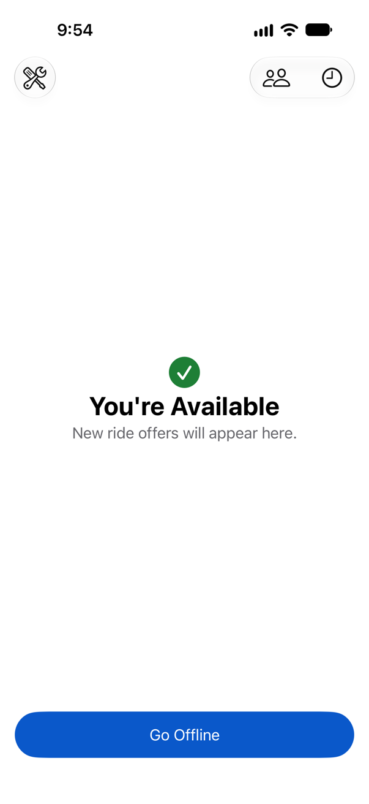
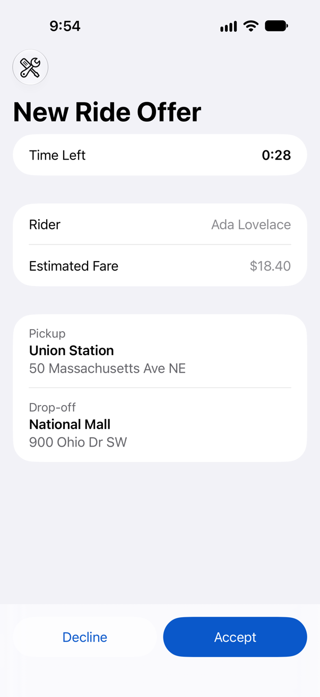
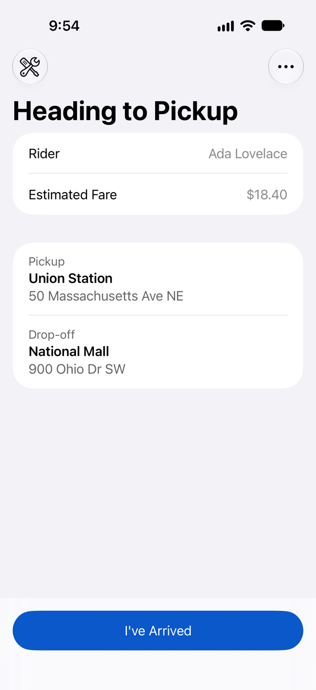
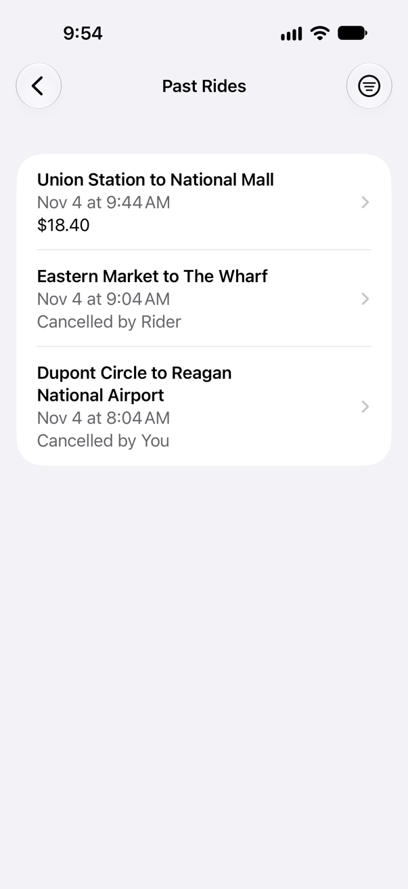
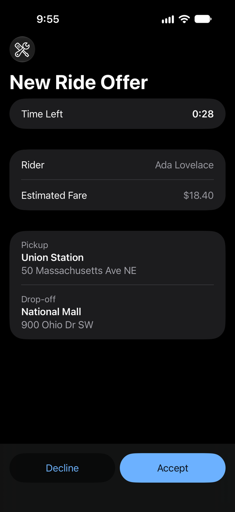

# Fareline

Fareline is a demo project, built as a take-home assignment: a simplified rideshare app for drivers, in Swift and SwiftUI for iOS 27. A driver goes online, answers ride offers, takes riders from a waiting list, works through each ride, and reviews past rides, including with no connection. All data comes from a mock service, so there's nothing to sign in to or configure.

<p>
  
  
  
  
</p>

The app supports dark mode, Dynamic Type up to the largest accessibility sizes, and VoiceOver.



## Requirements

- Xcode 27.2 or later
- An iPhone simulator running iOS 27.2 or later

The app has no third-party dependencies and needs no API keys or sign-in.

## Build and run

Open `Fareline.xcodeproj` in Xcode, select an iPhone simulator running iOS 27.2 or later, and press **Cmd+R**.

To run on a physical iPhone, select your own team and a unique bundle identifier under **Signing & Capabilities**. The simulator needs neither.

## Trying the app

The demo is set up so every feature can be reached in a few minutes. Offers come from four riders in turn, and the waiting list starts with riders who have already waited a few minutes.

### The main flow

1. Tap **Go Online**. An offer arrives about 5 seconds later, and stays for 30 seconds.
2. Tap **Accept**. The ride becomes the main screen, heading to the pickup.
3. Tap **I've Arrived**, **Start Trip**, then **Complete Trip**. You're available again, and the next offer is on its way.
4. Tap the clock button to see **Past Rides**. It opens on completed rides, and the filter button shows cancelled rides or all of them. Tap a ride for its details.

Go Online, Go Offline, Accept, Decline, and each ride step ignore taps for a moment after they appear. Accept appears where Go Offline was, and a tap meant for one shouldn't trigger the other.

### Waiting Riders

Declining an offer, or letting it expire, puts the ride in **Waiting Riders**, the people button on the home screen. While you're online, other drivers also pass on a new request every 20 seconds, until six riders are waiting.

- **Take Ride** starts a ride straight away, as accepting an offer does, and declines any offer you have.
- **Navy Yard to Union Market** belongs to Taylor Taken, a demo rider whose ride another driver takes just as you claim it. You're told the rider is no longer waiting, and the ride leaves the list.
- If an offer arrives while you're on Waiting Riders or Past Rides, it shows as a bar at the bottom, so you keep your place. Tap it to see the offer. If you decline, you're returned to where you were.

### Cancellations

- **You cancelling:** on the current ride, tap the **⋯** button, then **Cancel Ride**, and confirm. You earn no fare. Before the trip starts, the rider gets a new request in Waiting Riders, and if you took the ride from there, you're returned to the list.
- **A rider cancelling:** decline offers until one from **Will Cancel** arrives, from Eastern Market to The Wharf, and accept it. Will Cancel cancels 10 seconds after you accept, unless the trip has started, and you're told why your ride ended.

### Simulating no connection

The app has no real network, so a **Demo** menu lets you lose and restore the connection. It's the wrench button at the top left of the main screen, whether that's showing your status, an offer, or your current ride, and it's in Debug builds only, which is what Xcode runs.

- **Simulate No Connection** cuts the app off from the mock service. Requests fail and no updates arrive, while the service's own world keeps going, so offers still expire and riders still cancel.
- **Restore Connection** reconnects. The app receives everything that changed meanwhile, then sends any ride steps you took offline, in order.

Losing the connection is usually brief, so a toast says so for a few seconds over the top of the screen, without moving anything. It also confirms each ride step saved offline, and says when the connection is back. While there's no connection, a wifi-slash button stays in the navigation bar, with a badge counting the ride steps waiting. Tap it for what works without a connection. VoiceOver announces each change.

What works with no connection:

- **Your own ride's steps:** I've Arrived, Start Trip, Complete Trip, and Cancel Ride. Each shows straight away and is sent when the connection returns. A completed or cancelled trip keeps the time you tapped.
- **Reading:** your current ride, Past Rides, and Waiting Riders, as last received.

What needs a connection, and is disabled with a line saying so: going online or offline, accepting or declining an offer, and taking a ride from Waiting Riders. Each needs a live answer from the service.

To try it:

1. Tap **Go Online**, and accept the offer that arrives.
2. From the Demo menu, choose **Simulate No Connection**.
3. Tap **I've Arrived**, then **Start Trip**. The ride moves on, a toast confirms each step is saved, and the bar's badge shows 2.
4. Choose **Restore Connection**. A toast says 2 ride steps are being sent, the bar's button goes away, and the service records both steps.

To see a conflict, decline offers until one from **Will Cancel** arrives, and accept it. Will Cancel cancels 10 seconds after you accept. Lose the connection straight away and tap **I've Arrived**. After 10 seconds, restore the connection: the service refuses the step, as the rider has cancelled, and you're told the rider cancelled. If the service refuses a queued step for another reason, the steps after it are dropped, the ride shows as the service has it, and you're told your offline steps couldn't all be sent.

## Run the tests

In Xcode, press **Cmd+U**. This runs both test targets:

- **`FarelineTests`:** unit and integration tests in Swift Testing. They take under a second.
- **`FarelineUITests`:** UI tests in XCTest, which Swift Testing doesn't support. They run Apple's accessibility audit on every screen at the default and largest text sizes, and check how offers reach the driver. They take a few minutes.

From the terminal, replace `iPhone 18 Pro` with any iPhone simulator you have on iOS 27.2 or later. To see which ones are available, run `xcrun simctl list devices available`.

```sh
xcodebuild test \
  -project Fareline.xcodeproj \
  -scheme Fareline \
  -destination 'platform=iOS Simulator,name=iPhone 18 Pro'
```

To run only the unit tests, add `-only-testing:FarelineTests`.

## Lint

[SwiftLint](https://github.com/realm/SwiftLint) is optional and runs separately from the build, so you don't need it to build the app:

```sh
swiftlint lint
```

## Design

The plan's [decision log](docs/PLAN.md#decision-log) records every decision with its reasoning and what it cost. This section covers the main ones.

### Architecture and state management

```
SwiftUI views  →  DriverModel  →  DriverService  →  MockRideService
                                                          ↓
                                                     Domain rules
```

- **Domain:** rides, offers, and drivers are value types with their own state machines. A ride's status changes only through `apply(_:)`, which throws a typed error for a transition its lifecycle doesn't allow, so every rule is tested without UI or timing. The domain imports only Foundation.
- **Service:** `DriverService` is the boundary a real backend would sit behind. `MockRideService` implements it as an actor, playing the whole backend: who gets offered which ride, offer expiry, other drivers passing on requests, and riders cancelling. Each request suspends only once, for the simulated network delay, and then changes all its state without another `await`, so the actor makes every request atomic. Time comes from an injected `TimeSource`, so tests control it rather than wait for it.
- **State:** one `@MainActor @Observable` `DriverModel` is the source of truth, shared through the environment. Views render its `session`, ask it what the driver can do now, such as `canAnswerOffer`, and call its intent methods, such as `acceptOffer(id:)`. The model holds no business rules: it sends a request and replaces its state with the complete `DriverSession` the service returns.
- **Updates:** the service sends whole, versioned session snapshots through an `AsyncStream`, for changes the driver didn't ask for, such as a new offer. A request's result and a stream update can arrive in either order, so the model ignores any session older than the one it has.
- **Offline:** while the connection is down, the driver's own ride steps queue in the model. The screen shows the service's last session with those steps applied by the domain's own rules, through `DriverSession.applying(_:)`. On reconnecting, the steps are sent in order, and the service's answer wins any conflict.
- **Navigation:** the path is view state, held in `RootView`, but where the driver ends up as offers and rides come and go is decided by `AppNavigation`, a value type with its own tests.

**Why there are no view models.** Every screen shows parts of the same session, so a view model per screen would either pass the model's state through unchanged or copy it, bringing back the out-of-sync state that whole snapshots avoid. The jobs a view model does are still done, without the class: presentation logic is in small extensions that are tested on their own, such as `RideStatus+Display` and `PastRideFilter`, and decisions about what the driver can do are on the model. With Observation, views update from exactly the properties they read, which was the main reason for view models under Combine.

### Data storage

Past rides are saved as a JSON file in Application Support by `PastRideStore`, which the mock service owns, as a stand-in for a backend's database. Reading a ride replays the events that lead to its saved status, so a damaged file can't produce a ride its lifecycle doesn't allow, and a file that can't be read is moved aside rather than overwritten. Everything else lives in memory and starts fresh at launch.

In production, the backend's database would be the source of truth for rides and history. The app would keep an on-device cache of what it last received, so the driver can still read their ride and history offline, and save its queue of offline steps, so they survive a relaunch.

### Trade-offs

- **One app model rather than a view model per screen.** Every screen reads the same state, so nothing can disagree, and logic is tested through the model and small extensions. In exchange, `DriverModel` is the one place every action goes through, and it has to be kept from growing into everything.
- **Complete, versioned snapshots rather than individual changes.** The app can't merge changes wrongly or show an offer, ride, and driver that disagree, and ordering problems reduce to a version check. With large data or a real network, sending the whole session each time would be wasteful, and a backend might send changes instead.
- **One app target rather than a shared package.** A package would need `public` on every shared type and its own test target, for a rider app that may never exist. The domain depends on nothing in the app, so moving it later would be mechanical, but still some work.
- **An offer as the whole home screen, and a bar on other screens.** A driver who's available is waiting for offers, so taking over the home screen loses nothing, and an offer can't be swiped away and missed, as a sheet could be. A driver browsing Past Rides or Waiting Riders keeps their place. In exchange, an offer looks different depending on where the driver is.

### Simplifying assumptions

- There's one driver, with no sign-in, and riders, places, and other drivers come from fixed mock data.
- Every pickup and drop-off has a recognizable name, such as "Union Station". Real addresses often don't, so with real data a place's name would need to be optional.
- A driver handles one ride at a time, and a ride is offered to one driver at a time. It goes to another only after the offer is declined or expires.
- Other drivers are simulated. They pass on new requests until six riders are waiting, and one demo rider's ride is taken by another driver as this driver claims it. Waiting riders never give up.
- A driver can't go offline during a ride.
- An offer that's ignored expires, and the driver stays available.
- A rider can cancel until the trip starts. A driver can cancel at any stage, after a confirmation, and earns no fare. The mock has no distance travelled, so there's no partial fare for a trip ended early.
- Losing the connection is simulated with a Debug-only Demo menu. A real app would learn about its connection from `NWPathMonitor`.
- Ride steps taken offline don't survive relaunching the app, because the mock service restarts with it.
- When the service refuses a ride step taken offline, the service wins, and the steps after it are dropped, rather than each kind of conflict being resolved differently.
- Past rides are kept on the device, and aren't synced anywhere.
- The app runs in portrait on iPhone only.

### Design system and artwork

Colors are named tokens in the asset catalog, each with a light and dark value, such as `brandPrimary` and `textSecondary`. Views use only tokens, so changing a token changes every screen that uses it. `ColorTokenTests` checks every text and background pair against WCAG AA contrast in both modes.

The app icon and launch mark are drawn by a script from the same tokens. After changing a brand color, regenerate them from the repository root:

```sh
swift scripts/generate-artwork.swift
```

### Ready for a Rider Companion

The assignment says a Rider Companion app may follow. No rider code is built, but the code was audited so that one could be added without reworking the driver app.

**What a rider app would reuse:**

- **The ride domain.** `Domain/` imports only Foundation and knows nothing of the app, the service, or SwiftUI. Ride statuses describe the ride rather than the driver's view of it, such as `driverEnRoute` rather than `goingToPickup`, so a rider reads the same values. `RideRole` records who cancelled without taking a side. Rides, their events, and their rules carry over as they are, while the driver's own types, such as `DriverAvailability` and `RideOffer`, would simply go unused by a rider.
- **The rules for both parties.** The ride's lifecycle already holds the rider's rule, cancelling until the trip starts, and `RideStatus.canBeCancelled(by:)` answers it for either role. Ride state is separate from the driver's availability, which a rider never needs.
- **The service's conventions.** Complete, versioned snapshots, a `connectionUpdates()` stream, typed errors, and the injected `TimeSource` don't depend on who the client is. Some of `RideServiceError`'s cases, such as `networkUnavailable`, apply to either client, while others, such as `offerNoLongerAvailable`, are the driver's, and a rider contract would add its own.
- **The mock backend's state and rules.** `MockRideService` plays the whole backend, riders included: `simulateRideCancelled(id:)` already applies a rider's cancellation through the domain's rules. It can't simply conform to a rider contract too, as it serves one implied driver, and methods such as `sessionUpdates()` would clash. A rider app would add a rider-facing type over the same backend state, with the simulations becoming its real actions.

**What it would add:**

- **Its own contract and session.** The driver's contract is `DriverService`, returning a `DriverSession`. It was renamed from `RideService`, which sounded shared, though every method is a driver action. A rider app would add a `RiderService` beside it, with methods such as `requestRide(pickup:dropoff:)`, `cancelRide(rideID:at:)`, and `sessionUpdates()`, and a `RiderSession` holding the rider's current ride and history, with no offers or waiting list.
- **Who the driver is.** A ride holds only its driver's ID. A rider needs the driver's name and vehicle, which the rider session would carry.
- **A rider's history.** Saved past rides must have a driver, which suits a driver's history. A rider's would include rides they cancelled before any driver was assigned.
- **Its own wording.** Text such as "Heading to Pickup" and "Cancelled by You" lives in the driver app's display extensions, not the domain, so a rider app would write its own, such as "Driver on the way", from the same statuses.

**When to move to a shared package:** once a second app target exists, and not before. The package would hold `Domain/`, both service contracts with their sessions, and the mock, so each app could build and demo against it. With one app, a package adds cost and no benefit: every shared type and method would need to be `public`, and the package would need its own test target. Because the domain already depends on nothing in the app, the move would be mechanical.

### What I'd change or add with more time

#### In the app

- **A map of other drivers.** Nearby drivers and their status on a map, so a driver can see where others are waiting and position themselves. Drivers bunched in one area wait longer for offers, while other areas go unserved. It wasn't built because the mock has no real locations, so the map would show invented positions that never move. A useful version needs live locations from a backend, and location permission.
- **A list of other drivers and their statuses.** Whether each is available, on a ride, or offline, so a driver can tell how busy the area is and whether going online now is likely to bring offers. It wasn't built because the mock's other drivers would be invented and never change. A real version needs the backend's live view of all drivers, and showing drivers each other's status raises privacy questions.
- **Status outside the app.** A Live Activity on the Lock Screen and in the Dynamic Island showing whether the driver is online, so they can tell without opening the app. A driver who thinks they're online can miss offers, and one who forgets to go offline keeps receiving them. It wasn't built because it needs a backend sending push updates to stay correct while the app isn't running, which the in-process mock can't do.
- **A real network layer.** A `DriverService` that talks to a backend. Every method in the protocol is already `async throws`, so requests map straight onto `URLSession`'s async API, such as `data(for:)`. Live updates, such as a new offer, would arrive over a WebSocket and feed the same `AsyncStream` that `sessionUpdates()` returns now, and the connection would be reported by `NWPathMonitor`. The model and views wouldn't change.
- **Offline steps that survive a relaunch,** by saving the queue and the last session on the device.
- **Translations.** Text is already in a String Catalog, with plural forms, so adding a language is a matter of translating it.
- **Landscape and iPad layouts,** for drivers with a phone mounted sideways.

#### In the development process

These would help a larger project, but would cost more than they return here:

- **Living specs with OpenSpec,** in place of per-issue tracks. Specs that stay current describe the whole system rather than one change, but need tooling and a custom workflow to be worth it.
- **Parallel agents in separate git worktrees,** so independent issues can progress at once. Here, issues are worked one at a time so each can be reviewed closely.
- **CI** that runs the tests and SwiftLint on every PR. Here, both run locally before each PR.
- **Automated pre-PR gates as skills,** such as a single skill that runs the tests, lint, and reviews, and refuses to open a PR until they pass. Here, the plan's checklist does this by hand.

### AI tools used and how

The app was built with Claude Code, with a person directing each step and reviewing every change. The workflow:

- **A spec and plan for each issue.** Before any code, the `/start-issue` project skill reads the GitHub issue and writes a spec (the expected behavior and the cases the tests must cover) and a plan (phases with failing tests first and a verify step) in `docs/tracks/`. A person reviews both and settles open questions before work starts. Tracks begin with #8, so earlier issues don't have one.
- **Swift skills.** Skills for SwiftUI, Swift Concurrency, and Swift Testing are loaded while writing code, then used to review it before each PR. Their suggestions are weighed rather than applied automatically, and the toolchain wins when they disagree.
- **Tests that are checked.** Logic is written test first in Swift Testing. Before a test is relied on, the code it covers is broken on purpose to confirm the test fails, which has found missing tests and redundant code. UI changes are shown with screenshots from temporary UI tests that aren't kept, so the suite holds only UI tests worth their cost.
- **Automated review.** `/code-review` checks each PR for correctness bugs, and `/simplify` checks larger changes for over-engineering. Each finding is fixed or recorded with a reason in the PR.
- **A whole-project review.** Before the README, the project was reviewed as a Swift expert would evaluate it, and #41 fixed what that found: copied view code, rules that lived in views, untested navigation, and folders that mixed concerns.
- **Review by a person.** Every PR is read, questioned, and merged by a person, who must be able to explain all of the code.
- **Lessons file.** `CLAUDE.md` holds rules for the agent. A mistake it makes twice becomes a rule there, with the reason.
